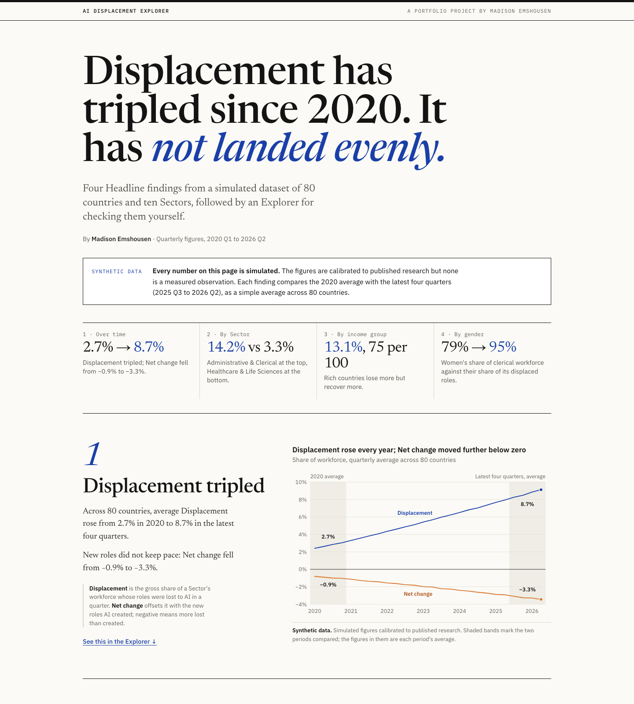
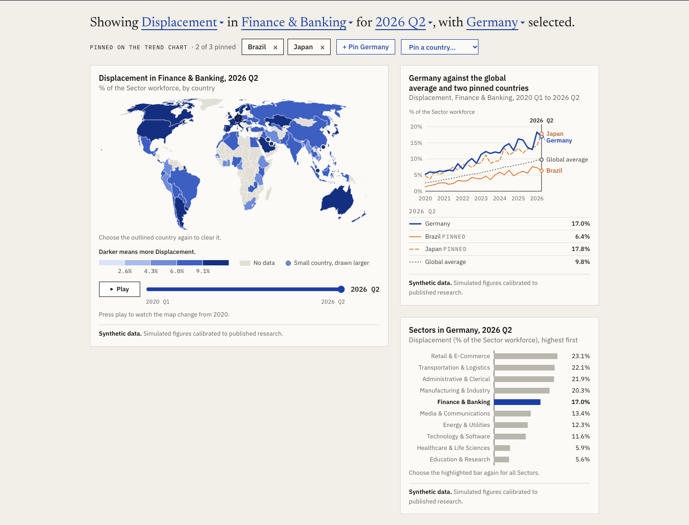
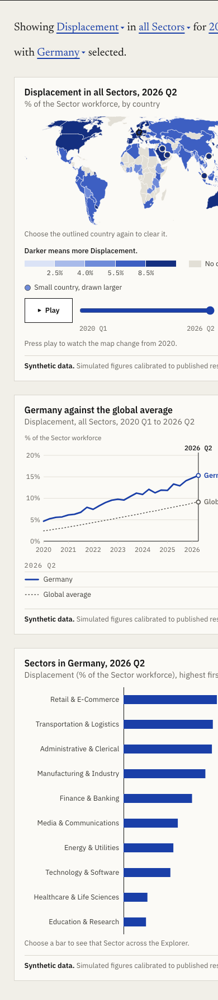

# AI Displacement Explorer

A one-page dashboard on how AI adoption is reshaping workforces across 80 countries and ten industry
Sectors: four Headline findings, then an Explorer for checking them yourself. Every number in it is
Synthetic data: simulated, not measured.

**Live site:** <https://memshousen.github.io/ai-displacement-explorer/> (published by the deploy
workflow on each push to `main`)







## Headline findings

Each finding compares the 2020 average with the latest four quarters (2025-Q3 to 2026-Q2), as a
simple average across the 80 countries. These are the figures the build generates from the CSV.

1. **Displacement tripled.** Average Displacement, the gross share of a Sector's workforce whose
   roles were lost to AI in a quarter, rose from 2.7% in 2020 to 8.7% in the latest four quarters.
   Net change, which offsets Displacement with the new roles AI created, fell from −0.9% to −3.3%.
2. **The Sector gap.** Administrative & Clerical has the highest Displacement of the ten Sectors,
   at 14.2%. Healthcare & Life Sciences (3.3%) and Education & Research (3.9%) are at the other end,
   at less than a third of that.
3. **Rich countries lose more but recover more.** High-income countries show 13.1% Displacement
   against 4.7% in low-income countries. They also show the highest Replacement rate: 75 new roles
   for every 100 displaced, against 20.
4. **Women in clerical work.** Women are 79% of the Administrative & Clerical workforce but 95% of
   its displaced roles. In every other Sector the two shares are within about 4 points of each
   other. (These shares are averaged over all 26 quarters.)

## About the data

The dataset is Synthetic data: simulated figures calibrated to published research, not measured
observations. Nothing here is a finding about the real world. The file,
`ai_workforce_displacement_global_2020_2026.csv`, came from Kaggle. Every row carries the same
`data_source_notes` value, which describes it as "Research-calibrated synthetic data" grounded in
WEF Future of Jobs 2025, Goldman Sachs GenAI Labour Report 2025, McKinsey State of AI 2025, OECD
Employment Outlook 2025, BLS O\*NET Automation Scores, Layoffs.fyi 2025, PwC AI Jobs Barometer 2025
and IMF WEO 2025. The site labels its numbers as Synthetic data in a note under the headline and in
the source line under every chart.

What a careful reader should know:

- **Coverage.** 80 countries, 10 Sectors and 26 quarters, 2020-Q1 to 2026-Q2: 20,800 rows, one per
  country, Sector and quarter. 2026 is a half year. Countries outside the 80 are drawn grey on the
  map as "No data".
- **Averages are unweighted.** The dataset has no workforce sizes, so every average is a simple
  average across countries and Sectors. A small country counts as much as a large one.
- **The low-income group is 3 countries**, against 31 high-income, 22 upper-middle-income and 24
  lower-middle-income. Its figures rest on very little.
- **Replacement rate by income group is suspiciously round.** The four groups come out at 74.7,
  55.4, 35.3 and 19.6, which round to 75, 55, 35 and 20. That looks like a setting in whatever
  generated the data, not a discovery.
- **Women's share of displaced roles in Administrative & Clerical is 95% in every country and
  every quarter.** It is one constant in the data, so the fourth finding shows how the dataset was
  built and cannot vary by place or time.
- **The wording is descriptive, never causal.** The site says what the figures are and how they
  differ. It does not say that AI adoption, income or policy causes any of it.

## How it is built

- **A static Astro site in TypeScript**, in `site/`. One page, no backend, no database and no
  interface framework.
- **A build-time data step** (`site/src/data/step/`) reads the CSV before every build, dev server
  start and type check. It fails the build, naming what is wrong, unless there is exactly one row
  for each of the 80 × 10 × 26 cells with no blank or non-numeric value in a column it needs. It
  writes two generated files that are never committed: the Headline findings' figures, and one data
  file for the Explorer holding all 20,800 cells (about 800 kB, about 207 kB gzipped).
- **Charts are hand-written SVG using D3 modules** (`d3-scale`, `d3-shape`, `d3-geo`, `d3-array`,
  `d3-interpolate`), with no charting package. The four Headline findings charts are drawn at build
  time, so they are in the HTML and appear with no JavaScript. The numbers in their text come from
  the generated figures, and the build stops if the fixed wording around them ("tripled", "less
  than a third") no longer matches the data.
- **The Explorer is drawn in the browser**: a world map, a trend chart and Sector bars, for six
  metrics (Displacement, Net change, Replacement rate, AI adoption index, AI skills wage premium,
  and women's share of displaced roles). Its only control is the Selection written as a sentence
  with clickable words, plus a quarter slider with a play button and clicking a country on the map.
  Up to three countries can be pinned on the trend chart. On a phone the views stack and there is
  no pinning.
- **One shared Selection, kept in the URL.** The metric, Sector, quarter, country and pinned
  countries drive all three views and are written to the address bar, so any view can be linked:
  `?metric=women-share&sector=administrative-clerical#explorer` opens the Explorer on the fourth
  finding.
- **Tests.** 244 unit tests in 14 files, run with Vitest (`npm test`). They cover the data step and
  its rejection of bad data, the Headline findings' figures, the Selection and its URL form, and
  the geometry and wording behind each Explorer view.
- **Deploy.** A GitHub Actions workflow (`.github/workflows/deploy.yml`) runs on every push to
  `main`: it installs dependencies, runs the type check, builds the site and publishes it to GitHub
  Pages.

## Run it locally

Requires Node 22.12 or newer.

```sh
cd site
npm install
npm run dev        # dev server at http://localhost:4321
```

Other commands, also run from `site/`:

```sh
npm run build      # build the static site into site/dist/
npm run preview    # serve the built site locally
npm run check      # type-check the .astro and TypeScript files
npm test           # run the unit tests
```

`site/README.md` has the detail for working on the site: the data step, the base path and the
design tokens.

## Repo layout

```
.
├── ai_workforce_displacement_global_2020_2026.csv   the dataset
├── eda_analysis.ipynb                               the earlier analysis notebook
├── docs/screenshots/                                the images in this README
├── .github/workflows/deploy.yml                     the GitHub Pages deploy
└── site/                                            the Astro site
    ├── astro.config.ts                              runs the data step before each build
    └── src/
        ├── pages/index.astro                        the one page
        ├── layouts/, components/, styles/           page structure and design tokens
        ├── data/                                    the data step and the modules that read its output
        ├── findings/                                the four Headline findings charts
        ├── selection/                               the Selection, its metrics and its URL form
        └── explorer/                                the sentence, map, trend chart and Sector bars
```

## The analysis notebook

`eda_analysis.ipynb` is where the project started: an exploratory pass over the same CSV in Python
with pandas and Plotly. It loads the data, prints summary tables, and draws nine charts (quarterly
trends, Sector, region and income group comparisons).

It is kept as a record and is not part of the site. The site does not read anything from it: the
Headline findings above are computed separately by the data step. The notebook's closing "Key
Findings" notes were written before that work and have not been checked against it. Some of their
figures do not match the data (they put Displacement at about 4%, where the quarterly average runs
from 2.4% to 9.1%), and they include causal claims and recommendations that the site deliberately
does not make. Where the two differ, the site is the one to trust.

To run it you need Python with `pandas` and `plotly`, and Jupyter. The repo has no requirements
file for it.

## How this was made

The project was planned in the open as a map of decision tickets in this repo's
[issues](https://github.com/MEmshousen/ai-displacement-explorer/issues/1): which Headline findings
to lead with, which views the Explorer has, how the data is shaped, what it looks like, which chart
library draws it. The code was written by AI coding agents working to those decisions. Madison
Emshousen made the decisions, and reviewed and merged the work.
